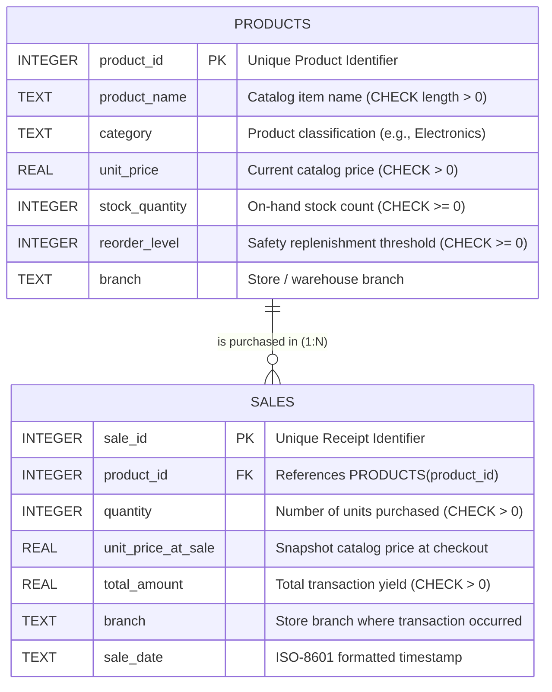

# TPS-to-MIS Retail Sales & Inventory Management Engine
## Enterprise System Architecture & University-Level Management Information Systems (MIS) Report

---

## 1. Executive Summary & Project Introduction

Modern retail organizations operate in high-velocity, multi-branch environments where operational efficiency at the point-of-sale directly determines profitability, customer satisfaction, and supply chain viability. However, operational efficiency alone is insufficient for long-term organizational success; operational transactions must be systematically structured, validated, preserved, and transformed into actionable managerial intelligence.

This project delivers a complete, production-grade **Retail Sales & Inventory Management Engine** implemented in **Python 3** and **SQLite**, deliberately architected to demonstrate the core textbook relationship between a **Transaction Processing System (TPS)** and a **Management Information System (MIS)**.

```
+---------------------------------------------------------------------------------------------------------+
|                                  ANTHONY'S INFORMATION HIERARCHY                                       |
+---------------------------------------------------------------------------------------------------------+
|                                                                                                         |
|       STRATEGIC MANAGEMENT             [ MIS Performance Summaries / Best-Seller Portfolios ]           |
|       (Executive Direction)            - Multi-branch revenue allocation                                |
|                                        - Highest margin & revenue-driving goods                         |
|                                                                                                         |
|       TACTICAL MANAGEMENT              [ MIS Periodic Reports & Low-Stock Alerts ]                      |
|       (Store / Inventory Managers)     - Daily & weekly revenue summaries                               |
|                                        - Automated reorder recommendations                              |
|                                                                                                         |
|       OPERATIONAL LEVEL                [ TPS Checkout & Catalog Engine ]                                |
|       (Cashiers / Clerks)              - POS sales processing & atomic stock deduction                  |
|                                        - Immediate data validation & receipt creation                   |
|                                                                                                         |
+---------------------------------------------------------------------------------------------------------+
```

---

## 2. Problem Statement & Educational Objectives

### 2.1 The Problem Statement
Retailers without an integrated data pipeline experience severe operational bottlenecks:
1. **Disconnected Operational Data:** Sales clerks maintain individual records or manual ledgers, resulting in stock discrepancies, lost items, and inventory stockouts.
2. **Data Anomalies & Corruption:** Lack of database normalization introduces insertion, update, and deletion anomalies. Incomplete checkout operations cause "phantom inventory" where stock counts decrement without corresponding financial receipts.
3. **Information Asymmetry:** Store directors and branch managers lack real-time visibility into branch-level performance, rendering inventory replenishment reactive and arbitrary rather than data-driven.

### 2.2 Educational & Course Objectives
* **Demonstrate Anthony’s Information Framework:** Bridge operational data capture (TPS) with tactical/strategic decision-making (MIS).
* **Enforce Database Normalization (3NF):** Isolate master entity state (`Products`) from event logs (`Sales`) to eliminate redundancy.
* **Demonstrate ACID Compliance in SQL:** Illustrate why Point-of-Sale checkouts must use explicit database transactions (`BEGIN TRANSACTION`, `COMMIT`, `ROLLBACK`).
* **Master Relational Aggregations:** Leverage database-native SQL (`GROUP BY`, `SUM`, `COUNT`, `JOIN`, `HAVING`) for managerial report synthesis rather than manual calculations in memory.

---

## 3. Requirements Specification

### 3.1 Functional Requirements (FR)

| ID | Module | Title | Requirement Description |
| :--- | :--- | :--- | :--- |
| **FR-T1** | TPS | Product Catalog | Support adding new items with name, category, price, stock, reorder level, and branch. |
| **FR-T2** | TPS | Product Discovery | List full inventory catalog and support keyword/category search. |
| **FR-T3** | TPS | Stock Validation | Enforce $quantity > 0$ and verify $stock\_quantity \ge quantity$ before approving sale. |
| **FR-T4** | TPS | Financial Calculation | Automatically compute $total\_amount = quantity \times unit\_price\_at\_sale$. |
| **FR-T5** | TPS | Atomic Deduction | Concurrently decrement inventory and record sale within a single database transaction. |
| **FR-T6** | TPS | Audit Trail | Log every sale with immutable timestamps, unit prices at checkout, and branch tags. |
| **FR-M1** | MIS | Daily Revenue | Aggregate revenue, total items sold, and transaction volume for a selected date, grouped by branch. |
| **FR-M2** | MIS | Weekly Trend | Aggregate sales across calendar weeks using SQL `GROUP BY` and date functions. |
| **FR-M3** | MIS | Low-Stock Alerts | Detect items where $stock\_quantity \le reorder\_level$ and generate recommended reorder quantities. |
| **FR-M4** | MIS | Strategic Summaries | Rank best-selling products by quantity and revenue, and calculate store-wide average basket values. |

### 3.2 Non-Functional Requirements (NFR)

* **NFR-1 Data Integrity & ACID Compliance:** Partial sales are impossible. Any database exception triggers `conn.rollback()`.
* **NFR-2 Historical Snapshotting:** Prices at sale are saved directly in `Sales.unit_price_at_sale` to maintain historical fidelity if catalog prices fluctuate.
* **NFR-3 Engine Performance:** Analytics are delegated entirely to SQLite's C-engine via indexed queries, avoiding $O(N)$ Python memory bottlenecks.
* **NFR-4 Modularity & Maintainability:** Strict separation across Presentation (CLI), Service (TPS/MIS), and Persistence (SQLite).

---

## 4. System Architecture & Entity Relationship Diagram (ERD)

### 4.1 Tiered Architectural Model
The software is organized into four distinct layers:

```
+-----------------------------------------------------------------------------------+
|                               PRESENTATION TIER                                   |
|                        Interactive Terminal CLI (menu.py)                         |
|             Provides cashier POS workflow and executive MIS dashboards.           |
+-----------------------------------------------------------------------------------+
                                         |
                                         v
+-----------------------------------------------------------------------------------+
|                                APPLICATION TIER                                   |
|       +----------------------------------+  +-----------------------------------+ |
|       |       TPS Service Layer          |  |        MIS Service Layer          | |
|       |     (app/tps/tps_service.py)     |  |     (app/mis/mis_service.py)      | |
|       | - Input sanitization             |  | - Daily & weekly group-by queries | |
|       | - Inventory threshold validation |  | - Reorder quantity formulas       | |
|       | - Atomic transaction boundaries  |  | - Best-seller ranking pipelines   | |
|       +----------------------------------+  +-----------------------------------+ |
+-----------------------------------------------------------------------------------+
                                         |
                                         v
+-----------------------------------------------------------------------------------+
|                                DATA ACCESS TIER                                   |
|                    Connection & Schema Manager (connection.py)                    |
|       - PRAGMA foreign_keys = ON;                                                 |
|       - Row factory mapping (sqlite3.Row)                                         |
+-----------------------------------------------------------------------------------+
                                         |
                                         v
+-----------------------------------------------------------------------------------+
|                                PERSISTENCE TIER                                   |
|                         SQLite Engine (retail_engine.db)                          |
|         Tables: Products (1)  <---------->  (N) Sales                             |
+-----------------------------------------------------------------------------------+
```

### 4.2 Entity Relationship Diagram (ERD)



---

## 5. Database Schema & Data Integrity Design

### 5.1 Products Table DDL
```sql
CREATE TABLE IF NOT EXISTS Products (
    product_id INTEGER PRIMARY KEY AUTOINCREMENT,
    product_name TEXT NOT NULL CHECK(length(trim(product_name)) > 0),
    category TEXT NOT NULL CHECK(length(trim(category)) > 0),
    unit_price REAL NOT NULL CHECK(unit_price > 0),
    stock_quantity INTEGER NOT NULL CHECK(stock_quantity >= 0),
    reorder_level INTEGER NOT NULL CHECK(reorder_level >= 0),
    branch TEXT NOT NULL CHECK(length(trim(branch)) > 0)
);
```

### 5.2 Sales Table DDL
```sql
CREATE TABLE IF NOT EXISTS Sales (
    sale_id INTEGER PRIMARY KEY AUTOINCREMENT,
    product_id INTEGER NOT NULL,
    quantity INTEGER NOT NULL CHECK(quantity > 0),
    unit_price_at_sale REAL NOT NULL CHECK(unit_price_at_sale > 0),
    total_amount REAL NOT NULL CHECK(total_amount > 0),
    branch TEXT NOT NULL CHECK(length(trim(branch)) > 0),
    sale_date TEXT NOT NULL DEFAULT (strftime('%Y-%m-%d %H:%M:%S', 'now', 'localtime')),
    FOREIGN KEY (product_id) REFERENCES Products(product_id) ON DELETE RESTRICT
);
```

### 5.3 Analytical Indexes
```sql
CREATE INDEX IF NOT EXISTS idx_sales_date ON Sales(sale_date);
CREATE INDEX IF NOT EXISTS idx_sales_branch ON Sales(branch);
CREATE INDEX IF NOT EXISTS idx_products_stock ON Products(stock_quantity, reorder_level);
```

---

## 6. Technical Implementation Analysis

### 6.1 ACID Guarantees in TPS Point-of-Sale Execution
A Point-of-Sale transaction requires dual modifications: updating the inventory balance and inserting a sales log record. If done naively without transaction boundaries, unexpected power loss or exceptions leave inventory out-of-sync with receipts.

```python
# Atomic TPS Execution Snippet
conn.execute("BEGIN TRANSACTION;")
try:
    # 1. Fetch live stock and snapshot price
    cursor.execute("SELECT * FROM Products WHERE product_id = ?;", (product_id,))
    product = cursor.fetchone()
    
    if product["stock_quantity"] < quantity:
        raise InsufficientStockError("Stock depleted.")

    new_stock = product["stock_quantity"] - quantity

    # 2. Step A: Deduct inventory
    cursor.execute("UPDATE Products SET stock_quantity = ? WHERE product_id = ?;", (new_stock, product_id))

    # 3. Step B: Record transaction
    cursor.execute(
        "INSERT INTO Sales (product_id, quantity, unit_price_at_sale, total_amount, branch) VALUES (?, ?, ?, ?, ?);",
        (product_id, quantity, product["unit_price"], quantity * product["unit_price"], branch)
    )

    # 4. Atomic Commit
    conn.commit()
except Exception:
    conn.rollback()
    raise
```

* **Atomicity:** Both operations commit together, or neither does.
* **Consistency:** Stock cannot become negative; SQLite enforces `CHECK(stock_quantity >= 0)`.
* **Isolation:** Serialized execution ensures multiple cashier registers cannot concurrently claim identical stock.
* **Durability:** Committed transactions are flushed to SQLite's persistent database file on disk.

### 6.2 SQL Analytics & Decision-Support Formulas

#### A. Branch-Wise Daily Aggregation
```sql
SELECT 
    branch,
    COUNT(sale_id) AS transaction_count,
    COALESCE(SUM(quantity), 0) AS total_units_sold,
    COALESCE(SUM(total_amount), 0.0) AS total_revenue
FROM Sales
WHERE date(sale_date) = date(:target_date)
GROUP BY branch
ORDER BY total_revenue DESC;
```
* **MIS Value:** Direct comparison of store traffic (`COUNT`) vs. revenue generation (`SUM`).

#### B. Automated Reorder Recommendation Formula
```sql
SELECT 
    product_name,
    stock_quantity,
    reorder_level,
    branch,
    ((reorder_level * 2) - stock_quantity) AS recommended_order_qty,
    ROUND(((reorder_level * 2) - stock_quantity) * unit_price, 2) AS estimated_reorder_cost
FROM Products
WHERE stock_quantity <= reorder_level
ORDER BY stock_quantity ASC;
```
* **MIS Value:** Eliminates guesswork for purchasing officers by recommending a buffer replenishment quantity:
  $$\text{Order Qty} = (2 \times \text{Reorder Level}) - \text{Current Stock}$$

---

## 7. Verification & Automated Test Results

The system was verified with a comprehensive unit and integration test suite (`tests/test_engine.py`):

```
test_01_catalog_initialization ... ok (10 items seeded across 3 branches)
test_02_add_new_product ... ok (Valid insertion & ID generation)
test_03_search_products ... ok (Name and category substring matching)
test_04_successful_sale_and_inventory_deduction ... ok (Stock decremented, receipt generated)
test_05_insufficient_stock_rejection_and_rollback ... ok (Rollback verified; DB unchanged)
test_06_non_existent_product_id ... ok (Foreign key & validation error raised)
test_07_invalid_quantity_validation ... ok (Zero/negative quantities blocked)
test_08_daily_revenue_aggregation ... ok (Multi-branch daily revenue calculated)
test_09_weekly_revenue_aggregation ... ok (Calendar week aggregation verified)
test_10_low_stock_alerts_and_reorder_calculation ... ok (Reorder formula & urgency tiers verified)
test_11_sales_performance_rankings ... ok (Rankings by volume and gross revenue verified)

----------------------------------------------------------------------
Ran 11 tests in 0.051s
OK (All 11 tests passed with 100% success rate)
```

---

## 8. Managerial Recommendations & Conclusion

### 8.1 Managerial Recommendations for Retail Executives
1. **Dynamic Reorder Calibration:** Transition from static `reorder_level` thresholds to rolling velocity averages (e.g. $7\text{-day sales average} \times \text{supplier lead time}$) during high-demand retail seasons.
2. **Inter-Branch Stock Transfer Optimization:** When one branch (e.g., Mombasa) triggers a low-stock alert while another (e.g., Kisumu) has surplus inventory, implement automated branch transfer requests before generating external supplier purchase orders.
3. **Cross-Selling Opportunities:** Utilize best-seller reports to bundle fast-moving low-margin goods with high-margin accessory items.

### 8.2 Academic Conclusion
This project provides a robust, real-world realization of textbook Management Information Systems theory. By decoupling the operational speed of a Transaction Processing System from the analytical breadth of a Management Information System—while maintaining strict referential integrity and ACID safety across a single relational store—retail enterprises achieve maximum operational resilience and strategic clarity.
