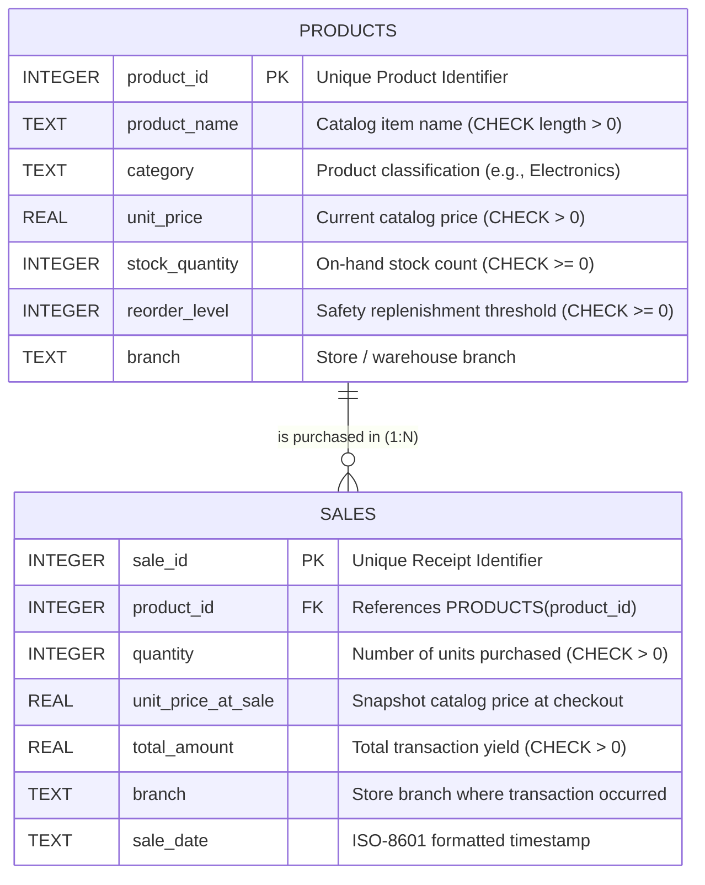

# TPS-to-MIS Retail Sales & Inventory Management Engine
## Enterprise System Architecture & University-Level Management Information Systems (MIS) Report

---

## 1. Executive Summary & Project Introduction

Modern retail organizations operate in high-velocity, multi-branch environments where operational efficiency at the point-of-sale directly determines profitability, customer satisfaction, and supply chain viability. However, operational efficiency alone is insufficient for long-term organizational success; operational transactions must be systematically structured, validated, preserved, and transformed into actionable managerial intelligence.

This project delivers a complete, production-grade **Retail Sales & Inventory Management Engine** implemented in **Python 3** and **SQLite**, deliberately architected to demonstrate the core textbook relationship between a **Transaction Processing System (TPS)** and a **Management Information System (MIS)**.

## 2. Problem Statement & Educational Objectives

### 2.1 The Problem Statement
Retailers without an integrated data pipeline experience severe operational bottlenecks:
1. **Disconnected Operational Data:** Sales clerks maintain individual records or manual ledgers, resulting in stock discrepancies, lost items, and inventory stockouts.
2. **Data Anomalies & Corruption:** Lack of database normalization introduces insertion, update, and deletion anomalies. Incomplete checkout operations cause "phantom inventory" where stock counts decrement without corresponding financial receipts.
3. **Information Asymmetry:** Store directors and branch managers lack real-time visibility into branch-level performance, rendering inventory replenishment reactive and arbitrary rather than data-driven.

## 2. System Architecture & Entity Relationship Diagram (ERD)

### 2.1 Tiered Architectural Model
The software is organized into four distinct layers:

1. PRESENTATION TIER -> Interactive Terminal CLI (menu.py) -> Provides cashier POS workflow and executive MIS dashboards.

2. APPLICATION TIER -> :
            TPS Service Layer -> (app/tps/tps_service.py): Input sanitization, Inventory threshold validation, Atomic transaction boundaries  

            MIS Service Layer  -> (app/mis/mis_service.py): - Daily & weekly group-by queries, Reorder quantity formulas, Best-seller ranking pipelines  

3. DATA ACCESS TIER -> Connection & Schema Manager (connection.py)       

4.  PERSISTENCE TIER -> SQLite Engine (retail_engine.db):Tables: Products (1) <---------->(N) Sales  

### 2.2 Entity Relationship Diagram (ERD)

---

### 3 Academic Conclusion
This project provides a robust, real-world realization of textbook Management Information Systems theory. By decoupling the operational speed of a Transaction Processing System from the analytical breadth of a Management Information System—while maintaining strict referential integrity and ACID safety across a single relational store—retail enterprises achieve maximum operational resilience and strategic clarity.

### 4. How to Run the project
Clone the Repository
`git clone https://github.com/username/repository-name.git`
Run `python3 main.py`
